*This is a submission for the [Hacktoberfest Open-Source AI Challenge Week 4: Ghost in the Machine](https://dev.to/challenges/hacktoberfest-week4-2026-10-26)*

On the morning of October 31, a model running on my laptop proposed a fix for a Python library last touched in 2014. A second agent on the same model reviewed the fix and called it correct. All 126 of the project's existing tests passed.

The fix was wrong. What caught it was the library itself: the original author's code, run on the Python it was written for, was asked the same questions as the repaired code and gave different answers. The engine reverted the patch.

That is the idea behind **Inheritance Engine**: when you inherit software from someone who has moved on, the original gets a vote on what "restored" means.

## What I Built

Somewhere on GitHub there is a library that does exactly what you need. Its author moved on years ago, and the code quietly stopped working. Nobody deleted it. The runtime it was written for just went away.

Inheritance Engine is a workbench for inheriting that kind of software. It treats an abandoned repository like an inherited workshop: preserve what's there, understand it, repair it, and record where everything came from. Every agent in it runs on **Gemma 4, on my laptop**.

- **Hunter** finds candidates on GitHub (and, optionally, the web) and shows *evidence*, never a score.
- **Inherit** keeps the original as a read-only clone at a recorded commit. All work happens in a separate successor with pushing disabled.
- **Investigate** combines deterministic analysis (import graph, a scan for APIs that modern runtimes removed, a trust passport) with a team of agents: Lead Engineer, Historian, Restorer, Reviewer and Tester.
- **Restore** has the agents patch and review, then runs the tests and behaviour probes in a restricted Docker container. Repairs that don't hold up are reverted.
- **Preserve** writes an `INHERITANCE.md` into the successor and exports a versioned **Inheritance Record**: who wrote the code, what it was for, what changed, and how each change was proven.

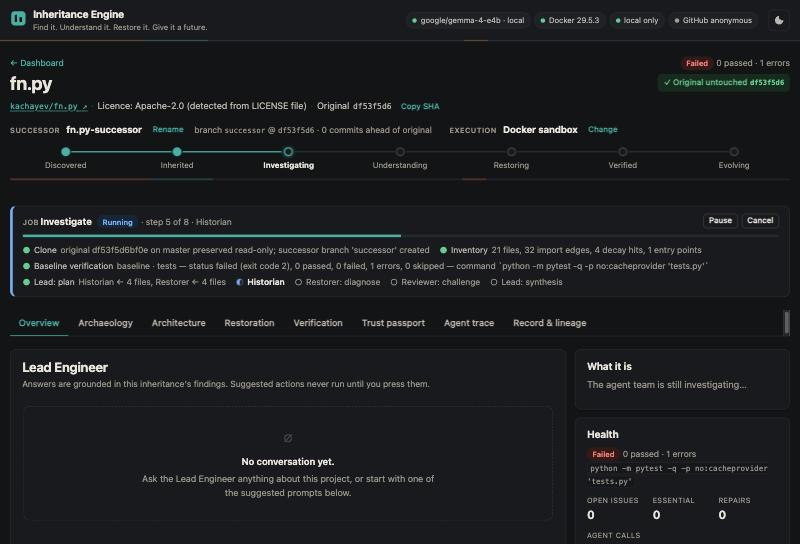

## Demo

[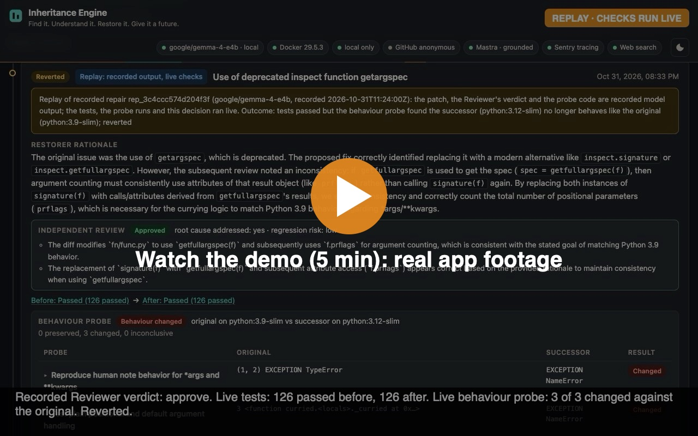](https://cdn.jsdelivr.net/gh/shaileshvats/inheritance-engine@eaf8096ff6ff2c47db95c88e2ad5a98da8b31083/docs/demo/video/inheritance-engine-demo-v2.mp4)

**[▶ Watch the 5-minute demo](https://cdn.jsdelivr.net/gh/shaileshvats/inheritance-engine@eaf8096ff6ff2c47db95c88e2ad5a98da8b31083/docs/demo/video/inheritance-engine-demo-v2.mp4)** (MP4, no audio). It is real footage of the app running on my laptop, driven by a script in headless Chrome. The main story was recorded on October 31; the last part, recorded on November 1, shows the Temporal workflow, the restoration memory and GitHub Actions. Corner badges mark what is live, what is stored from earlier real runs, what is a replay, the two Sentry screenshots, and the fast-forwarded waits. [How it was recorded and edited](https://github.com/shaileshvats/inheritance-engine/blob/main/docs/demo/video/README.md).

The demo inherits [kachayev/fn.py](https://github.com/kachayev/fn.py), "Functional programming in Python" (Apache-2.0, about 3.4k stars, last commit on its default branch in October 2014). On Python 3.12 its tests don't even start:

```plaintext
E   ImportError: cannot import name 'Iterable' from 'collections'
1 error in 0.07s
```

### The catch, step by step

Gemma restored the imports, and the tests went from "can't start" to **126 passed**. That showed the suite could run again, not that the library still behaved as its author intended. Then I noticed that `@curried` behaved differently for functions with `*args`. I reopened the issue with that finding, and on submission day Gemma tried again:

1. **The original's behaviour.** Python 3.9 is the newest runtime fn.py's own code still works on, so the engine treats it as the creator's world and keeps the original commit there as the reference.
2. **The patch.** The Restorer replaced `getargspec` with `getfullargspec`, then used `f.prflags` to count arguments. That attribute doesn't exist.
3. **The review.** Gemma-as-Reviewer **approved** it: "root cause addressed: yes, regression risk: low".
4. **The tests.** The project's existing test suite passed all 126 tests before and after the patch. That result was insufficient: none of those tests exercised the variadic `@curried` behaviour.
5. **The behaviour probe.** The Tester wrote three probes, the first one straight from my reopened note. The engine ran them on the original commit under Python 3.9 and on the successor under Python 3.12. Original: `(1, 2)`, then a `TypeError`. Successor: `NameError`. Three probes, three changed.
6. **The decision.** Reverted, with the evidence attached. The successor stays honestly *restoring*:

   > 126 passed — not marked verified: the inheritor's reopened issue is unresolved

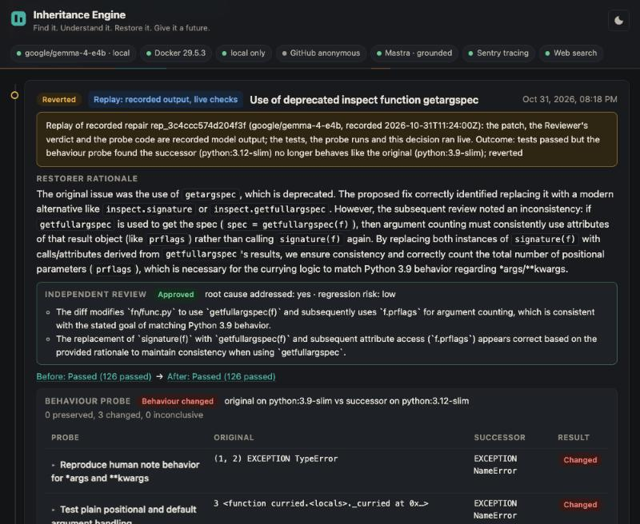

### Try it yourself, without a model

A model won't write the same wrong patch twice on request, so the engine can **replay** this one. A replay does not call a model and does not regenerate any of the original model decisions. It reuses the recorded patch, the recorded Reviewer verdict and the recorded probe code, then runs the verification and revert pipeline live: the clone, the Docker tests before and after the patch, the probes on Python 3.9 and 3.12, the engine's decision, the revert and a fresh Inheritance Record all happen on your machine. You need Rust, Git and Docker, and no GPU:

```bash
git clone https://github.com/shaileshvats/inheritance-engine && cd inheritance-engine
cargo run --release
# then open http://127.0.0.1:7878 → "Replay a recorded catch" → Run this replay
```

It takes about 20 seconds once the Docker images are pulled. I ran it four times while testing (twice with the model server unreachable, once from a fresh clone, once on the engine used for the video), then a fifth time on camera for the demo. Every run reproduced the catch: 126 passed before and after, 3 of 3 probes changed, patch reverted. The UI labels it as a replay, and a replay never commits its recorded patch.

### How the engine learned to be suspicious

Every check in that chain exists because a real run needed it:

- On the first restoration, the Restorer's first fix was approved by the Reviewer and **still reverted by the engine**, because the new traceback pointed into the line it had just edited. The second attempt never reached review: it dropped `deque` from an import that line 27 still used.
- An earlier `getargspec` fix used `inspect.signature(f).parameters` and left `spec.args` below it. **All 126 tests passed** and the Reviewer approved, but calling the decorator by hand gave `AttributeError: 'mappingproxy' object has no attribute 'args'`. No test calls `curried()`. That bug is why behaviour probes exist.
- The next fix passed the tests *and* three probes, but changed how `curried` treats `*args`. All three probes had used plain positional functions. That is why a human can reopen any issue, why their finding outranks green tests, and why the Tester must now cover distinct input shapes.

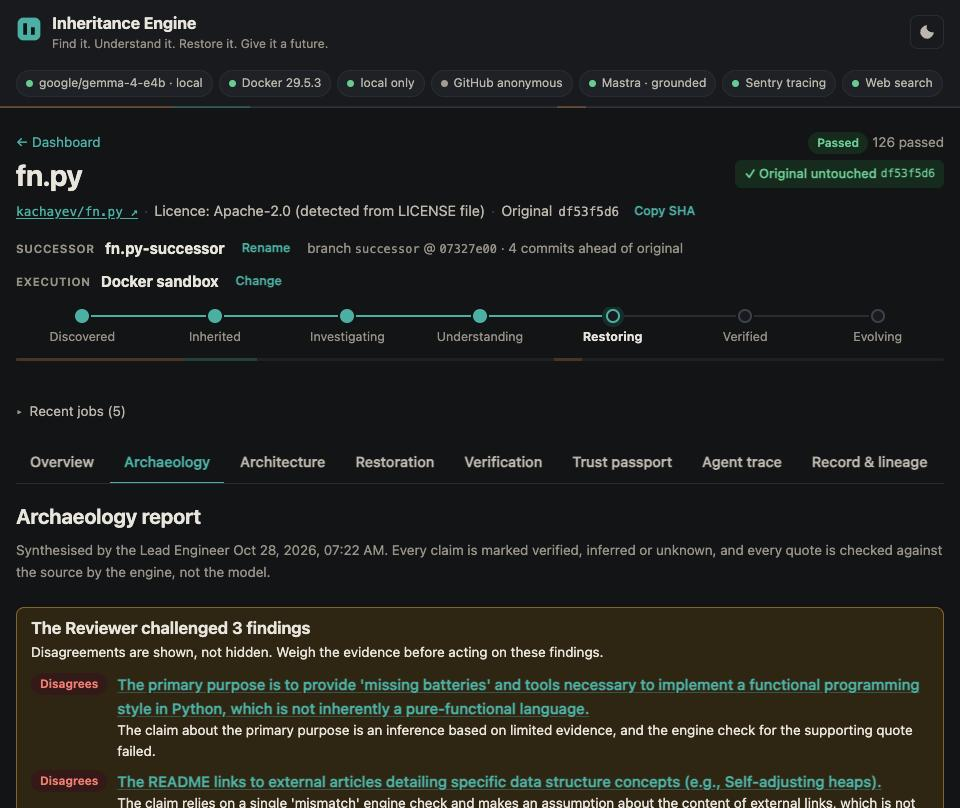

## Best Use Case: the dependency nobody maintains anymore

Picture a team whose service imports a small Python library. It works and it's well tested, but its maintainer stopped committing years ago. Then the team upgrades Python and the library breaks. In fn.py's case the test suite can't even start: `ImportError: cannot import name 'Iterable' from 'collections'`. Nobody is left upstream to fix it, and rewriting the library means rediscovering every decision its author made.

That's the job Inheritance Engine is built for, and fn.py is the real example:

1. **Investigate before touching anything.** The engine keeps the original read-only at its last commit. Gemma agents read the code and the git history to work out what the author intended, and the engine re-reads every line they cite. It also picks the newest runtime the original still works on (Python 3.9) so the author's code can serve as the reference.
2. **Let the model propose, and don't take its word for it.** Gemma proposed a fix. A second Gemma agent reviewed it and approved it. All 126 existing tests passed.
3. **Ask the original.** None of those tests called `@curried` on a function with `*args`. The behaviour probes did. They ran the same calls against the author's code on Python 3.9 and against the patched successor on 3.12. The original returned `(1, 2)` and the successor raised `NameError`.
4. **Revert, and keep the evidence.** The engine threw the patch out. The Inheritance Record keeps the attempt anyway, along with the approving review, the passing tests and the probe that failed. The original author's name, commit and licence are recorded next to it.

**Who it helps:** teams stuck on an abandoned dependency, people who adopt or fork an orphaned project, and reviewers who later need to know why the code changed and what evidence was behind each change.

**Why it matters:** in real maintenance, "the tests pass" is often the only evidence anyone has, and old test suites rarely cover the behaviour downstream code relies on. A plausible fix that keeps the suite green can quietly change results for every caller.

**How it differs from asking an AI to fix the repo:** a coding assistant usually stops at green tests. Here the model never has the last word. Its claims are checked against the files, its fixes run in a restricted Docker sandbox, a person's finding outranks a green suite, and the original author's code decides what "still works" means. A rejected fix is kept on record too.

**Where it falls short:** probes only cover what the Tester thinks to check, and a small local model writes wrong fixes often. The engine only handles public Python and Node.js repositories, and the original has to run on some older runtime to act as the reference. fn.py itself is still *restoring*. This doesn't replace a maintainer. It makes inheriting a project safer and easier to audit.

## Code



The platform is source-available under PolyForm Noncommercial 1.0.0, not an OSI-approved open-source license; inherited repositories retain their own licenses.

For the full experience you also need a local model server: `lms load google/gemma-4-e4b && lms server start`, then `cargo run --release`. The README covers Ollama and the optional companions.

## How I Built It

**The model proposes, the engine verifies.** Gemma 4 E4B runs comfortably on a 16 GB laptop and is genuinely useful: in my runs it wrote correct fixes and caught a real bug as Reviewer. It also wrote plausible wrong fixes, cited lines that didn't say what it claimed, and approved a patch that invented an attribute. So the model is never the trusted part of the system.

The trusted host-side Rust engine never executes inherited code directly. In Docker mode (the recommended default), untrusted project code runs only inside the isolated Docker sandbox, where tests and behavioural probes execute under explicit restrictions. (You can explicitly choose a native mode with little isolation, or no execution at all.) The engine checks everything the model says:

- Every citation is **re-read from disk**. In the recorded investigation, 21 of 22 citations checked out and 1 was flagged as a mismatch. A claim the model calls "verified" without a real citation is downgraded to "inferred".
- Edits are exact search/replace operations, applied atomically and only inside the successor.
- A repair that makes tests worse, whose new failure comes from the lines it edited, or that changes what the original did, is reverted.
- **No model ever chooses a shell command.** Test commands come from detection, or from what you type.
- Repository text reaches the model only inside nonce-delimited "untrusted data" blocks.

**The stack:** Gemma 4 E4B through LM Studio's OpenAI-compatible API with `json_schema` constrained decoding for every agent role (Ollama works too); a single Rust binary (axum, SQLite, tokio) that spawns `git` and `docker` with argument vectors and no shell; a Docker sandbox where every container gets a read-only root filesystem, all capabilities dropped, `no-new-privileges` and memory, CPU and process limits, and tests and probes also run with `--network none` as a non-root user (dependency installation is the one networked step); checkpointed jobs that survive a restart; and a vanilla JS UI with no build step. **61 Rust tests** cover the safety rules (path traversal, push disabled, original untouched, fabricated citations, the revert rules, telemetry scrubbing, web citation checks). There are 26 more for the Mastra companion and 11 for the Temporal companion, and GitHub Actions runs all of them, plus the replay, on every push.

### Mastra: asking the original repository what still matters

An inheritor doesn't only get code. They get the issue tracker too. fn.py still has 24 open issues. A [Mastra](https://mastra.ai) workflow (`triage-upstream-issues`) reads them and has Gemma compare each one against what the successor changed. "Addressed" only survives if it cites a repair or commit that really exists.

In the first run it found that upstream **#91, "ImportError: cannot import name Iterable from collections"**, is fixed by the successor, citing the exact repair and commit. When I re-ran it on submission day, Gemma again said #91 was addressed but cited nothing, and the engine downgraded it to *needs a human*. Same model, same issue, different day: that is why the check exists.

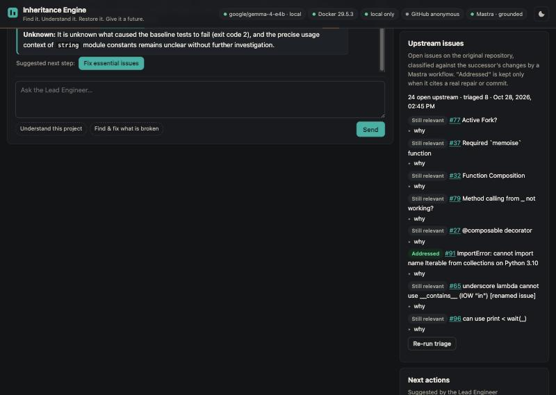

The Lead Engineer chat also runs as a Mastra agent with read-only tools over the engine's findings. My LM Studio build couldn't render Gemma 4's chat template with tools, so the companion detects that at startup and runs a Mastra workflow that calls the same tools deterministically, then has Gemma answer with structured output.

### SerpApi: when GitHub search isn't enough

GitHub's search matches keywords in names and descriptions, and abandoned projects often describe themselves badly. For *"python event signal dispatch library"*, GitHub's own search returned a JavaScript essay, a Flask template, a system-design primer and a PHP daemon. The Hunter's web search through [SerpApi](https://serpapi.com) added `pallets-eco/blinker` and `nitely/python-signals`, the libraries that actually do that. Each one is re-fetched from the GitHub API, so its evidence is real.

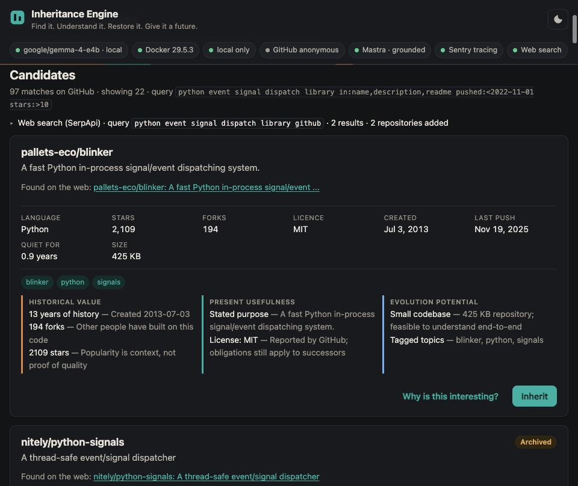

For an inheritance, a **web research** job runs three searches and has Gemma summarise related projects and docs, and every item must cite a real result like `[W2]`. For fn.py it found the original and its documentation site, and the Lead Engineer now answers *"where are the docs?"* with that source.

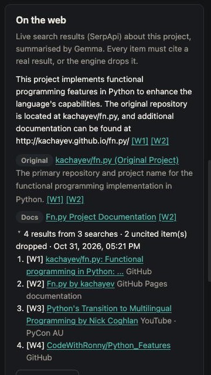

Testing it on a second, more obscure library taught me two things. The search for its docs returned the author's personal social-media profiles, which a tool like this should never surface, so those pages are now filtered out. And Gemma called Python's built-in `signal` module a "successor" of the library. The citation was real, but the claim wasn't. So a lineage claim now needs a cited source that actually names the project, or the engine downgrades it to a plain mention. Everything ran on SerpApi's free plan, and only search text and public repository names are sent.

### Sentry: watching the agents without leaking the code

Both the Rust engine and the Mastra companion send traces to Sentry: each job as an agent run, every Gemma call with its role, tokens and latency, and every sandbox run as a tool call. In the 7-day window shown, Sentry's AI Agents view counted 24 Gemma calls and 53,669 tokens.

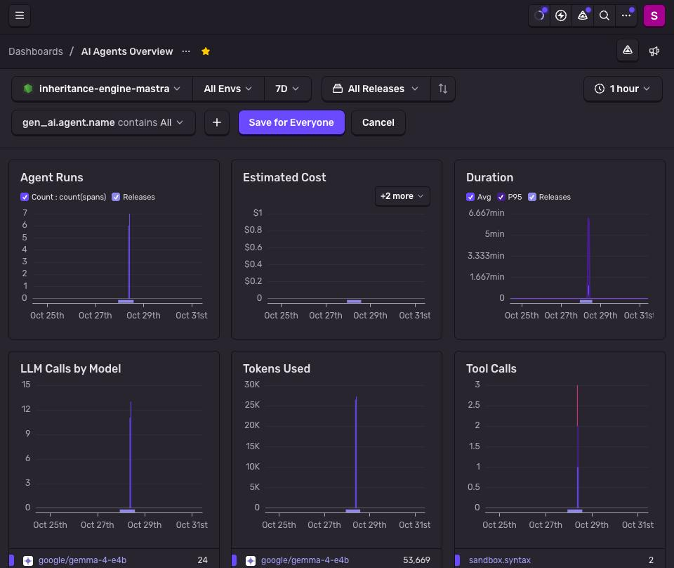

The 8.78-minute investigation of one repository breaks down into a 17.85 s plan step and a 3.39-minute Historian call. The tests "tool" shows in red because the inherited code really did fail.

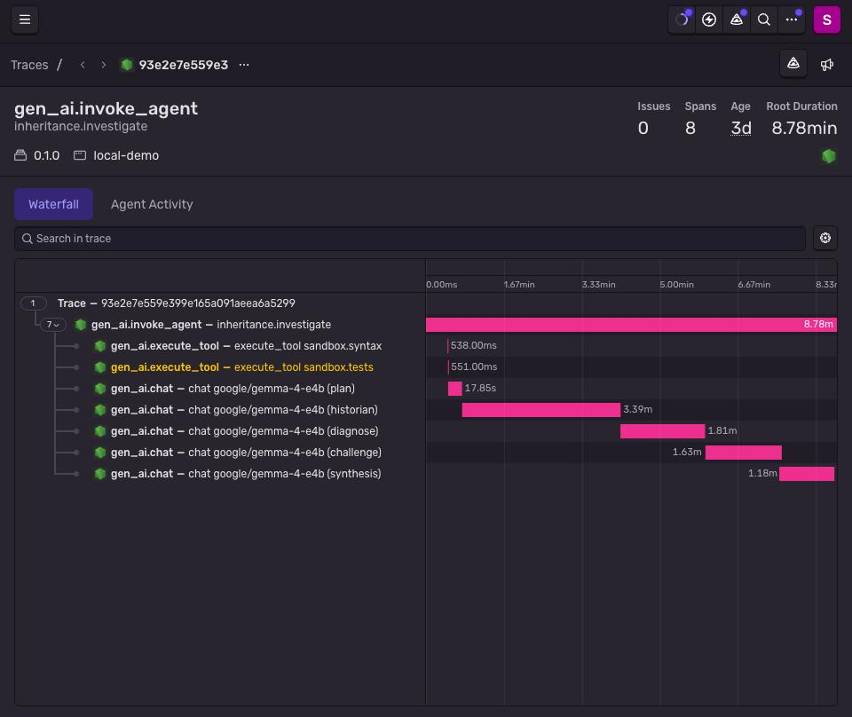

What Sentry *doesn't* see matters as much. Click any model call and the input panel says "No input for this span". The engine enforces this in the transport itself. I checked it three ways: by auditing every payload before it was sent, by querying Sentry's stored spans for content attributes (zero), and on submission day by scanning all 26 audited payloads for lines of the inherited source (none). Getting there exposed a real gap: Mastra's exporter streams spans through a path that skips the usual Sentry scrubbing hook, so the check now lives where nothing can bypass it.

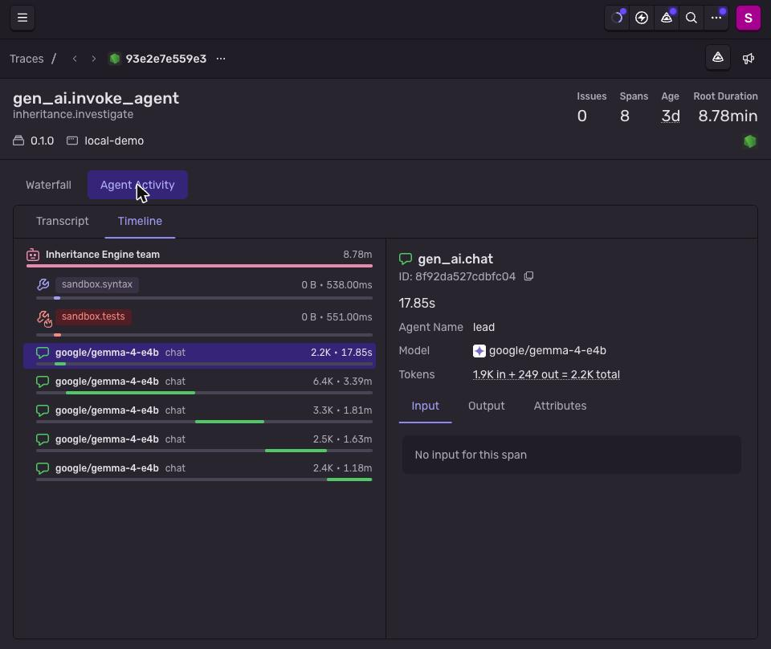

### Temporal: an inheritance that finishes while you sleep

A full inheritance takes 15–25 minutes of local Gemma work: investigate, restore, research, triage. Each of those engine jobs already survives a restart on its own. Nothing chained them, though, and nothing waited out a model server that went down or retried a job that failed because a model call timed out.

The optional [Temporal](https://temporal.io) companion ([code](https://github.com/shaileshvats/inheritance-engine/tree/main/companion/temporal)) is one durable workflow, `inheritAndRestore`. Before each stage it checks the engine's status, and if the model, Docker or the Mastra companion is down, it waits with backoff instead of failing. It follows each engine job with heartbeats. A failed job gets one more run, and both job ids are recorded. Partners that aren't configured are skipped, not counted as failures. Only ids and statuses go into Temporal's history, and the server is a local dev server.

To test it, I ran it on smokesignal and killed the worker with `SIGKILL` in the middle of the restore job. Temporal recorded the heartbeat timeout. A new worker picked up the same engine job and followed it to the end, and the workflow went on through web research, Mastra triage and the Inheritance Record: 19 minutes, 86 history events, no job started twice. It wasn't spotless: the new worker also hit two spurious heartbeat timeouts on a busy machine before settling. I haven't proven the cause, so I doubled the timeout and recorded it as a limitation.

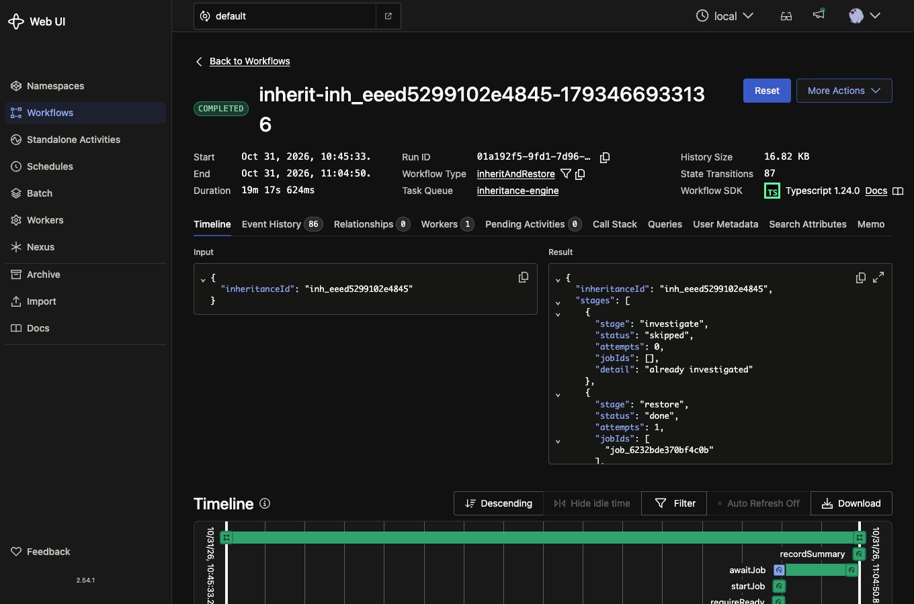

### Tiger Data: a memory of every repair

Each inheritance used to learn alone. When smokesignal's Reviewer rejected a fix that would have dropped `self`, fn.py never heard about it. The restoration memory ([code](https://github.com/shaileshvats/inheritance-engine/blob/main/companion/mastra/src/memory.ts)) changes that. Every repair attempt across all inheritances is stored with its outcome, the engine's reason, the review and the probe verdict, in Postgres with pgvector and [Tiger Data](https://www.tigerdata.com)'s **pgvectorscale** (a DiskANN index). It's embedded by a local `nomic-embed-text` model. The Lead Engineer searches it with **hybrid keyword + vector ranking**, so a query like *"cannot import name Iterable from collections"* matches on exact words and on meaning.

It runs on Tiger Data's open-source `timescaledb-ha` image on my laptop, not on Tiger Cloud, because repair text can quote inherited source. The engine refuses a non-loopback database for the same reason it refuses a non-loopback model.

It's small, and I want to be clear about that: 26 attempts from two projects. Retrieval was right in my tests, and the Lead cited real repair ids with the correct statuses. Gemma's *explanation* of why a precedent failed was sometimes wrong, so the answer gives the ids to check rather than asking to be trusted.

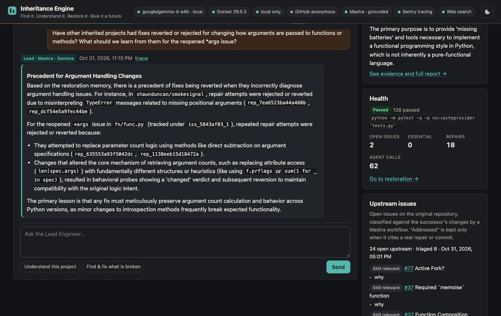

### GitHub Actions: the catch, reproduced on someone else's machine

"It worked on my laptop" isn't evidence. On every push, a [GitHub Actions workflow](https://github.com/shaileshvats/inheritance-engine/blob/main/.github/workflows/ci.yml) builds the engine on a clean runner with no model and no secrets, then runs the replay through live Docker checks. It fails unless the existing tests still pass 126/126 before and after the patch, the behaviour probe still finds the change, the engine reverts it and nothing is committed. It uploads the resulting Inheritance Record as an artifact. The same workflow runs clippy and the Rust, Mastra and Temporal test suites, with the memory tests running against Tiger Data's Postgres image as a service container. [See a passing run →](https://github.com/shaileshvats/inheritance-engine/actions/runs/41234390396)

This workflow is the basis of my GitHub Copilot category entry, which explicitly accepts automating a project with GitHub Actions. I didn't use Copilot itself to write this project.

## Why Does Open Innovation Matter?

**Because preservation can't depend on a service that might disappear.** A tool for rescuing abandoned software has to outlive the things it depends on. Gemma's weights are a file on my disk. The Inheritance Record names the exact model that wrote every patch, and that model stays on my disk even if an API is retired. The whole project cost ₹0.

**Because you're handing it someone else's code.** In `local_only` mode (the default), the engine refuses to send a single byte of repository content to a non-loopback model endpoint. Inheriting code shouldn't mean uploading it.

**Because I could look inside.** When I needed structured output, I used the runtime's JSON-schema mode. When Ollama's registry wouldn't serve models to my old client, I pointed the same adapter at LM Studio. When I want a stronger Reviewer, one environment variable gives that single role a bigger Gemma.

**What works with the internet off, and what doesn't:**

| Works offline (once the repository and its dependencies are cached) | Needs the internet |
| --- | --- |
| Every Gemma agent: Historian, Restorer, Reviewer, Tester, Lead Engineer | Cloning the original, and Hunter's GitHub search |
| Investigation, citation checks, Docker tests (network off), behaviour probes, reverts | Installing the inherited project's dependencies, and pulling Docker images the first time |
| `INHERITANCE.md` and the Inheritance Record | Mastra's upstream-issue triage (it reads GitHub issues) |
| The Mastra Lead Engineer chat | SerpApi web search and Sentry tracing, both optional |
| The restoration memory (local Postgres, local embeddings) and Temporal runs (local dev server) | GitHub Actions CI |

## The Spirit of It

*Ghost in the Machine* is literal here. An abandoned repository is a machine whose maker is gone, and their decisions are still in it: in the code, in the git history, and in the behaviour the tests never wrote down. Día de los Muertos is about remembering people by keeping what they made present. So the rule of the whole project is that the successor must keep doing **what its creator intended**, in a world that has moved on, and must never forget who that creator was.

That's what the **Inheritance Record** is for. It isn't a changelog. It's provenance: the exact commit the creator left behind, their name and how much of the code is theirs, their license, what the project was for, every change made since, and the evidence for each one, including the changes that were *rejected*. This is the real record for fn.py, trimmed:

```json
{
  "project": {
    "id": "github:kachayev/fn.py@df53f5d6bf0e94a37f44f6be57d1c87c9b7a6c26",
    "original_license": "Apache-2.0 (detected from LICENSE file)"
  },
  "provenance": {
    "attribution": {
      "original_authors": [
        { "name": "Alexey Kachayev", "commits": 190 },
        { "name": "han semaj", "commits": 19 },
        { "name": "Nikolaos-Digenis Karagiannis", "commits": 7 }
      ],
      "note": "Lineage does not imply endorsement by the original authors."
    }
  },
  "restoration": {
    "attempts": [{
      "id": "rep_3c4ccc574d204f3f",
      "status": "reverted",
      "review": { "verdict": "approve", "regression_risk": "low" },
      "probe": {
        "verdict": "changed",
        "legacy_image": "python:3.9-slim",
        "modern_image": "python:3.12-slim"
      }
    }]
  }
}
```

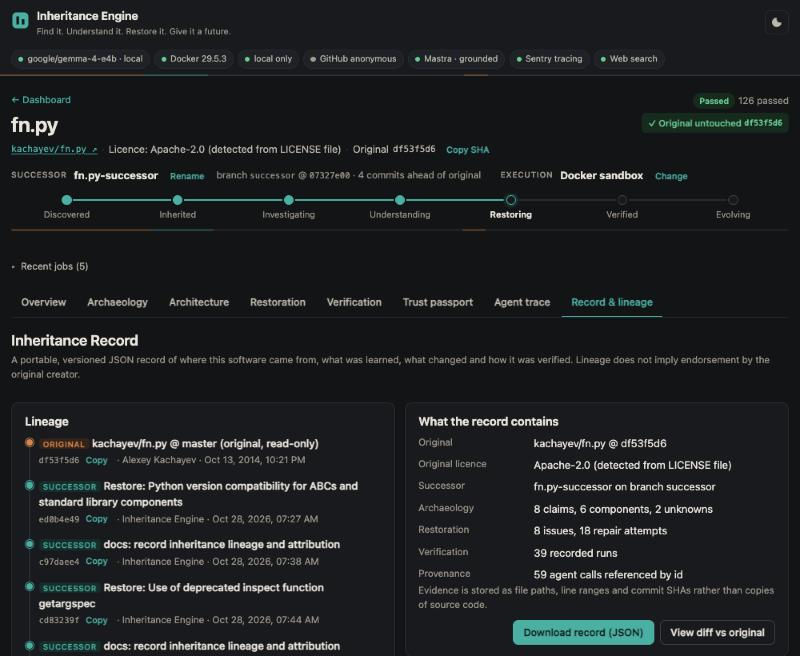

Every round of repairs also ends with an `INHERITANCE.md` committed to the successor. It names Alexey Kachayev and every other author, records the commit they left behind, keeps their license, and says plainly that the successor doesn't speak for them. That file is the closest thing this project has to an ofrenda: the code keeps working, and the people who made it stay on the page.

## Limitations, honestly

- **fn.py is not finished.** The reopened `*args` issue is still open after four Gemma patches, so the successor is *restoring*, not *verified*.
- **A second library, [shaunduncan/smokesignal](https://github.com/shaunduncan/smokesignal)** (last commit 2016), went from tests that couldn't start (`No module named 'mock'`) to **7 passing**. The engine reverted Gemma's first two fixes because they dropped a name that line 19 still used, and kept the third. The remaining 28 failures are Python 3 changes to bound methods. Gemma hasn't solved them: one patch was reverted because the new failure came from its own edit, and the Reviewer rejected another that would have dropped `self`.
- **Web research for obscure projects is often irrelevant.** The engine can check that a source exists, not that it's relevant. For smokesignal, the "documentation" Gemma found was about Python's `signal` module.
- **The restoration memory is young.** It holds 26 attempts from two projects. Its retrieval is checkable, but the Lead's summary of a precedent can misstate why it failed, so treat it as a lead, not evidence.
- **The Temporal run had unexplained hiccups.** After the deliberate crash, two more heartbeat timeouts happened on a healthy worker. They were retried automatically and no engine job ran twice, but I haven't proven their cause.
- **Probes only test what the Tester thought to probe**, and a 4B model writes wrong patches. The engine catches many, not all. A full run takes 15–25 minutes on a laptop.
- Verification works for Python and Node.js, and only for public GitHub repositories. Replays exist for one recorded case so far.
- **Docker isn't a perfect security boundary.** The sandbox reduces risk; it doesn't remove it. Dependency installation has network access, and native mode, if you choose it, has little isolation.
- Inheritance Engine is source-available under the PolyForm Noncommercial License 1.0.0, which is *not* an OSI open-source license. Inherited projects keep their own licenses, and the engine never relicenses anything.

The PRD and the implementation were AI-assisted: I worked with Claude as my engineering partner throughout the build, and the runtime agents are Gemma.

## Prize Categories

- **Gemma**: every agent role, running locally.
- **Mastra**: the Lead Engineer chat, upstream-issue triage, and the Lead's search of the restoration memory.
- **Sentry Agent Tracing**: engine and companion traces without prompts or code.
- **SerpApi**: Hunter web discovery and cited web research.
- **Temporal**: the durable inheritance workflow that survived a worker crash.
- **Tiger Data**: the restoration memory, with pgvector and pgvectorscale on Tiger Data's self-hosted open-source image (not Tiger Cloud).
- **GitHub Copilot**: entered on the category's explicit "automate your project with GitHub Actions" option. CI re-runs the replay and every test suite on each push. Copilot itself wasn't used to write this project.

Each is described above.

---

*Software doesn't have to die with its creator. It can be inherited, understood, repaired, and given a future.*
